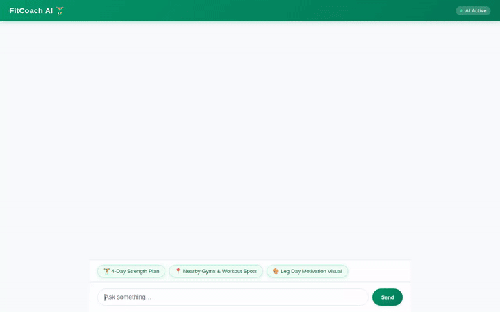

# FitCoach AI 🏋️‍♂️

FitCoach AI is an intelligent, personalized fitness assistant built with Google Cloud's **Agent Development Kit (ADK)** and deployed on **Vertex AI Agent Engine**. It helps users design tailored workout plans, look up exercise techniques, locate nearby gyms and fitness spots, generate motivational workout visuals, and track training goals with persistent memory across sessions.



---

## 🌟 Key Features & Google Cloud Architecture

FitCoach AI leverages a suite of Google Cloud services and Google GenAI models:

* **🧠 Persistent Cross-Session Memory**:
  * **Vertex AI Memory Bank**: Integrates `VertexAiMemoryBankService` to extract user preferences, fitness goals, and personal bests across chat sessions.

* **🗄️ Workout Plan Database**:
  * **Google Cloud Firestore**: Queries the `workout_plans` collection to retrieve curated workout routines filtered by training category, difficulty, duration, and target heart rate zones.

* **🎨 Generative Media Tools**:
  * **Image Generation**: Uses **Gemini 3.1 Flash Lite** (`gemini-3.1-flash-lite-image`) to generate motivational fitness graphics. Images are saved as ADK artifacts and uploaded to a public **Google Cloud Storage** bucket.
  * **Video Generation**: Uses **Gemini Omni** (`gemini-omni-flash-preview`) in the `global` region to generate short exercise demonstration videos saved as artifacts and hosted on Cloud Storage.

* **📍 Location & Mapping Services**:
  * **Google Geocoding API**: Converts city names or street addresses into precise geographic coordinates (`geocode_address`).
  * **Google Places API (New)**: Discovers nearby gyms, parks, and sports complexes based on user coordinates (`find_nearby_places`).

* **📚 Exercise Database Integration**:
  * **wger Workout Manager API**: Searches an open-source exercise database (`search_exercise_library`) for detailed exercise descriptions, required equipment, and targeted muscle groups.

* **💻 Secure Code Execution**:
  * **Agent Engine Sandbox**: Executes Python calculations and data processing safely inside `AgentEngineSandboxCodeExecutor`.

* **🖼️ Rich A2UI Interface**:
  * **A2UI (v0.8 Basic Catalog)**: Formats workout recommendations into structured visual cards (Cards, Columns, Rows, Text, Images) rendered natively in both ADK Web and the custom frontend.

* **🧮 Built-in Utilities**:
  * Mathematical expression evaluation, currency conversion, weather reporting, and timezone time lookups.

---

## 🏗️ Project Structure

```text
.
├── app/
│   ├── agent.py          # Root ADK Agent, tools, system prompt, and A2UI callbacks
│   ├── a2ui_utils.py     # A2UI response formatting & payload extractor
│   ├── fast_api_app.py   # FastAPI wrapper endpoint
│   └── deployment_metadata.json
├── frontend/
│   ├── main.py           # FastAPI proxy server (A2A protocol bridge)
│   └── static/
│       └── index.html    # Rebranded FitCoach AI web chat interface & A2UI renderer
├── demo.gif              # Inline demonstration recording
├── agents-cli-manifest.yaml
└── requirements.txt
```

---

## 🚀 Local Setup & Run Instructions

### Prerequisites

* Python 3.10+
* Google Cloud project with Vertex AI, Firestore, and Cloud Storage enabled
* `gcloud` CLI authenticated (`gcloud auth application-default login`)

### 1. Installation

Clone the repository and install the dependencies:

```bash
pip install -r requirements.txt
```

### 2. Environment Configuration

Create a `.env` file in the project root:

```env
GOOGLE_MAPS_API_KEY=your_google_maps_api_key_here
```

### 3. Run with ADK Web UI

Start the Agent Development Kit local development web server:

```bash
adk web app
```

### 4. Run Custom FastAPI Frontend

To run the custom chat frontend locally:

```bash
cd frontend
pip install -r requirements.txt
python main.py
```

Open a web browser and navigate to the server port printed in the terminal console (default port 8080).
